# Reconocimiento de género musical por su ritmo

**Teoría de Señales** · Ingeniería de Sistemas y Telecomunicaciones · Universidad de Manizales

**Integrantes:** Manuel Leonardo Díaz Castaño · Stiven Gómez Henao · Juan José Arciniegas

---

## 1. Descripción

La señal que estudiamos es **audio musical**: una canción es una señal de presión acústica
x(t) que se graba, se muestrea y se guarda como una secuencia de números x[n].

El objetivo es un sistema que **identifique el género de una canción a partir de su ritmo**,
usando 10 s de audio. En esta entrega se trabaja con siete géneros y 34 canciones: **salsa,
reggaetón, bachata, vallenato, cumbia, rock y electrónica**. Para la entrega final se agregarán
más géneros (balada, entre otros) y más canciones.

El ritmo no se ve directamente en la forma de onda, porque está mezclado con la melodía y la
armonía. Lo que se repite son los **ataques**: los instantes en que empieza un golpe de bombo,
de caja, de güira o de campana. Por eso el sistema construye una señal nueva, la **envolvente
de ataques**, que vale mucho cuando empieza un golpe y casi cero en el resto, y estudia la
periodicidad de esa señal: con la autocorrelación obtiene el tempo, con la FFT su espectro
rítmico, y doblándola sobre una rejilla de 16 semicorcheas obtiene el **patrón del compás**
(el "dibujo" del ritmo: el dembow del reggaetón, el bombo en cada pulso de la electrónica, la
caja en 2 y 4 del rock, el contratiempo de la cumbia).

```
audio → mono, 22 050 Hz → fragmentos de 10 s → STFT → flujo espectral en 3 bandas (envolventes de ataques)
      → autocorrelación (tempo, subdivisión) + patrón de compás (16 pasos) → 52 características → k-NN → género
```

## 2. Estado actual

**Funciona y se puede reproducir:**

- Carga de MP3 o WAV de cualquier fs y número de canales, mezcla a mono, filtro antialiasing y
  remuestreo a 22 050 Hz, normalización y segmentación en fragmentos de 10 s.
- Análisis de la señal con las 34 canciones: forma de onda, caracterización, espectro (FFT),
  muestreo y aliasing, efecto del ruido y segmentación (`python main.py analizar`).
- Análisis rítmico: espectrograma, envolventes de ataques por banda, autocorrelación y tempo,
  espectro de la envolvente y patrón de compás.
- Primer clasificador por **k vecinos más cercanos**: **79 % de las canciones** (27 de 34) y
  62 % de los fragmentos de 10 s bien clasificados, con validación dejando una canción por fuera
  (azar: 14 %).
- Clasificación de un archivo o de una grabación con el micrófono.
- Generador de ritmos sintéticos, para probar el código sin canciones.

**Falta para la entrega final:**

- Más géneros (balada y otros) y más canciones por género, de más artistas. Con 4–5 canciones
  por género, cada canción mal clasificada mueve la exactitud 3 puntos.
- Separar mejor **vallenato y cumbia** (5 de los 7 errores son entre estos géneros) y **rock y
  electrónica**; probablemente haga falta una descripción más fina de la subdivisión.
- Resolver la **ambigüedad de octava del tempo**: el vallenato se mide a veces en ~77 BPM y a
  veces en ~130 BPM (ver 7.6).
- Probar con grabaciones reales por micrófono (hasta ahora el ruido es simulado).
- Incorporar los temas que faltan del curso (diseño formal de filtros para separar las bandas,
  por ejemplo) y comparar el k-NN con otros clasificadores.

## 3. Datos y recursos

### 3.1 Canciones

| Archivo | Título | Artista |
|---|---|---|
| `salsa_01.mp3` | Periódico de Ayer | Héctor Lavoe |
| `salsa_02.mp3` | Vivir Mi Vida | Marc Anthony |
| `salsa_03.mp3` | Cali Pachanguero | Grupo Niche |
| `salsa_04.mp3` | La Cura | Frankie Ruiz |
| `salsa_05.mp3` | Pedro Navaja | Rubén Blades |
| `reggaeton_01.mp3` | Gasolina | Daddy Yankee |
| `reggaeton_02.mp3` | Dale Don Dale | Don Omar |
| `reggaeton_03.mp3` | Mi Gente | J Balvin y Willy William |
| `reggaeton_04.mp3` | Tití Me Preguntó | Bad Bunny |
| `reggaeton_05.mp3` | Rakata | Wisin y Yandel |
| `bachata_01.mp3` | Obsesión | Aventura |
| `bachata_02.mp3` | Propuesta Indecente | Romeo Santos |
| `bachata_03.mp3` | Corazón Sin Cara | Prince Royce |
| `bachata_04.mp3` | Princesa | Frank Reyes |
| `vallenato_01.mp3` | Los Caminos de la Vida | Los Diablitos |
| `vallenato_02.mp3` | La Gota Fría | Carlos Vives |
| `vallenato_03.mp3` | Olvídala | Binomio de Oro de América |
| `vallenato_04.mp3` | Las Locuras Mías | Silvestre Dangond |
| `vallenato_05.mp3` | Esta Vida | Jorge Celedón |
| `cumbia_01.mp3` | La Pollera Colorá | Wilson Choperena y Juan Bautista Madera |
| `cumbia_02.mp3` | Cómo Te Voy a Olvidar | Los Ángeles Azules |
| `cumbia_03.mp3` | Cumbia sobre el Río | Celso Piña |
| `cumbia_04.mp3` | El Pescador | Totó la Momposina |
| `cumbia_05.mp3` | Tabaco y Ron | Rodolfo Aicardi |
| `rock_01.mp3` | We Will Rock You | Queen |
| `rock_02.mp3` | Smells Like Teen Spirit | Nirvana |
| `rock_03.mp3` | Back in Black | AC/DC |
| `rock_04.mp3` | De Música Ligera | Soda Stereo |
| `rock_05.mp3` | Seven Nation Army | The White Stripes |
| `electronica_01.mp3` | One More Time | Daft Punk |
| `electronica_02.mp3` | Titanium | David Guetta y Sia |
| `electronica_03.mp3` | Levels | Avicii |
| `electronica_04.mp3` | Summer | Calvin Harris |
| `electronica_05.mp3` | Don't You Worry Child | Swedish House Mafia |

- Las canciones tienen derechos de autor y **no se suben al repositorio** (`.gitignore`). La
  tabla dice cuáles son para que cualquiera pueda conseguirlas; las instrucciones para
  nombrarlas están en [`data/canciones/LEEME.md`](data/canciones/LEEME.md).
- El género de cada archivo se toma del inicio de su nombre (`salsa_01.mp3` → salsa).
- Son 34 canciones completas (de 2 a 7,5 minutos; 141 minutos en total), todas MP3 a 44,1 kHz
  en estéreo. La bachata tiene 4 canciones: el archivo de *Tengo un Amor* (Toby Love) llegó
  repetido y se dejó por fuera; se agregará para la entrega final.

### 3.2 Ritmos sintéticos (control)

`python main.py sinteticos` genera 4 "canciones" de 30 s para cada uno de 8 géneros (44,1 kHz, WAV) en
`data/sinteticos/`. Cada una suma percusiones sintetizadas (bombo: senoide con barrido de 135 a
45 Hz; caja y güira: ruido filtrado pasabanda con caída exponencial; campana: dos ondas
cuadradas de 562 y 845 Hz; congas: senoides con caída), un bajo y acordes, sobre el patrón
típico de cada género, con variaciones aleatorias de tempo, ±4 ms de imprecisión, intensidad,
volumen por instrumento y notas omitidas. El tempo real de cada una queda en
`data/sinteticos/tempos_reales.csv`, lo que permite comprobar el estimador de tempo. Son un caso
de control (se sabe exactamente qué patrón tiene cada género), **no reemplazan a las canciones**.

### 3.3 Ruido

Se genera por código con parámetros documentados (`src/ruido.py`): ruido blanco gaussiano
(densidad espectral plana) y ruido rosa (densidad 1/f, parecido al ruido ambiente), escalados
para una SNR dada: **SNR = 10·log10(P_señal / P_ruido) dB**, con semilla fija (0).

## 4. Cómo ejecutar

**Software:** Python 3.10 o superior (probado con 3.13). Librerías: NumPy, SciPy, Matplotlib,
soundfile (lectura de WAV y MP3) y sounddevice (solo para el micrófono). Si soundfile no puede
leer un archivo, el programa intenta con librosa o con ffmpeg, si están instalados.

```bash
git clone <url-del-repositorio>
cd genero-ritmo
pip install -r requirements.txt     # en Windows: py -m pip install -r requirements.txt
# copiar las canciones en data/canciones/ (ver data/canciones/LEEME.md)

python main.py analizar          # forma de onda, caracterización, FFT, muestreo, ruido, segmentación → results/
python main.py evaluar           # clasificador k-NN con validación dejando una canción por fuera → results/
python main.py clasificar data/canciones/cumbia_02.mp3
python main.py ritmo data/canciones/reggaeton_01.mp3     # análisis rítmico de un archivo
python main.py grabar            # graba 10 s con el micrófono y predice el género
```

Sin canciones se puede probar todo con los ritmos sintéticos:

```bash
python main.py sinteticos        # genera data/sinteticos/
python main.py analizar          # si data/canciones/ está vacía, usa data/sinteticos/
python main.py evaluar
```

`python main.py` sin argumentos abre un menú. Con `--no-mostrar` las figuras se guardan en
`results/` sin abrir ventanas; con `--carpeta RUTA` se elige otra carpeta de canciones.

**Estructura:**

```
genero-ritmo/
├── main.py                 punto de entrada (llama a src/cli.py)
├── src/
│   ├── config.py           todos los parámetros: fs, STFT, bandas, tempo, segmentación, k
│   ├── carga.py            lectura, mono, remuestreo, normalización, fragmentos
│   ├── ritmo.py            espectrograma, envolventes de ataques, autocorrelación, tempo, patrón de compás
│   ├── caracteristicas.py  vector de 52 características rítmicas por fragmento
│   ├── clasificador.py     k-NN, validación, matriz de confusión
│   ├── analisis.py         análisis de la señal (Entrega 2)
│   ├── ruido.py            ruido blanco, rosa y filtro de micrófono
│   ├── sinteticos.py       generador de ritmos de prueba
│   ├── microfono.py        grabación
│   ├── graficas.py         figuras
│   └── cli.py              comandos y menú
├── data/                   canciones (no se suben), ritmos sintéticos (se generan)
├── results/                figuras y tablas generadas
├── docs/                   metodología y documentos de las entregas
└── requirements.txt
```

## 5. Conceptos de Teoría de Señales utilizados

| Concepto | Dónde se usa |
|---|---|
| Señal continua x(t) y discreta x[n] = x(n·Ts) | Lectura del archivo; figura 7.2 (c) |
| Muestreo: fs y Ts = 1/fs | Archivo: 44 100 Hz, Ts = 22,68 µs. Sistema: 22 050 Hz, Ts = 45,35 µs. Envolvente: 86,13 Hz, Ts = 11,6 ms |
| Teorema de Nyquist y aliasing | Justificación de fs (sección 6); filtro antialiasing antes de submuestrear (7.4) |
| Componente DC, energía, potencia, RMS, factor de cresta, saturación, dB | Caracterización (7.3); normalización |
| Transformada discreta de Fourier (FFT), resolución Δf = fs/N, método de Welch | Espectro de cada canción (7.4); espectro rítmico (7.5 d) |
| Ventana de Hann y fuga espectral | FFT, STFT y espectro rítmico |
| STFT, espectrograma, compromiso tiempo-frecuencia | Base de las envolventes (7.5) |
| Derivada discreta y rectificación de media onda | Flujo espectral: solo cuentan los aumentos de energía |
| Filtrado por bandas (pasabajos, pasabanda, pasaaltos) | Separación en graves, medios y agudos; media móvil para quitar la tendencia |
| Periodicidad y **autocorrelación** | Tempo y subdivisión del pulso (7.5 c) |
| DFT de una secuencia periódica y propiedad de desplazamiento circular (\|X[k]\| no cambia si la secuencia se desplaza) | Forma del patrón de compás (7.7) |
| Ruido blanco y rosa, SNR | Degradación controlada (7.8) |
| Segmentación en tramas y fragmentos | STFT, ejemplos del clasificador (7.9) |
| Análisis de componentes principales (PCA) | Mapa de las características (7.10) |

La metodología completa, con todos los parámetros y las fórmulas, está en
[`docs/metodologia.md`](docs/metodologia.md).

## 6. Muestreo: valores y justificación

| | Archivo original | Sistema | Envolvente de ataques |
|---|---|---|---|
| fs | 44 100 Hz (típico de MP3) | **22 050 Hz** (44 100 / 2) | 22 050 / 256 = **86,13 Hz** |
| Ts = 1/fs | 22,68 µs | 45,35 µs | 11,61 ms |
| Nyquist fs/2 | 22 050 Hz | 11 025 Hz | 43 Hz |

**Por qué 22 050 Hz y no menos:** el ritmo lo marcan también los instrumentos agudos: hi-hat,
platillos, güira, guacharaca y maracas tienen su energía entre 3 y 10 kHz y son los que llevan
las subdivisiones (las semicorcheas de la güira en la bachata, el raspado continuo de la
guacharaca en el vallenato). Con 22 050 Hz el Nyquist queda en 11 025 Hz y la banda de agudos
(2–10 kHz) se conserva completa; con 11 025 Hz se perdería la mitad de esa banda. En las 34
canciones, por encima de 11 kHz queda en mediana el 0,3 % de la energía (2,3 % en el peor caso,
*Periódico de Ayer*), y bajar a la mitad reduce a la mitad el cálculo. Antes de bajar la tasa se
aplica un filtro pasabajos antialiasing (7.4).

**Por qué la envolvente puede ir a 86 Hz:** es una señal lenta. Un ritmo de 600 golpes por
minuto son 10 Hz, muy por debajo de su Nyquist de 43 Hz. La resolución temporal de 11,6 ms es
menor que la imprecisión normal de un músico (unos 10–20 ms).

## 7. Resultados actuales

Todos los resultados de esta sección se obtienen con las 34 canciones de la tabla 3.1 y se
regeneran con `python main.py analizar` y `python main.py evaluar` (unos 3 minutos en total).
Las figuras de detalle usan, de cada género, la canción con menos muestras saturadas (7.3).

### 7.1 Forma de onda x(t)

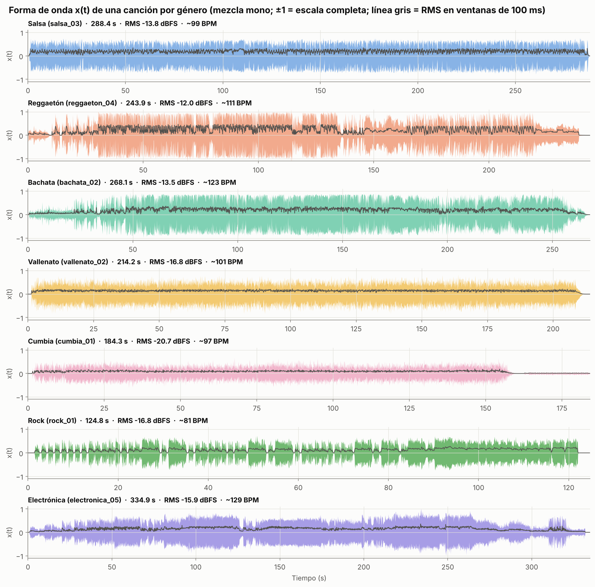

Una canción por género, completa, con su valor RMS en ventanas de 100 ms (línea gris). Se ven la
amplitud, la duración y la estructura de cada canción:

- **Rock (*We Will Rock You*):** las ráfagas separadas por silencios cortos son el "pisotón,
  pisotón, palmada" que se repite en toda la canción: el ritmo se ve incluso a esta escala.
- **Electrónica y reggaetón:** subidas y caídas de intensidad (introducciones, cortes y
  "drops"), típicas de música producida para bailar.
- **Cumbia (*La Pollera Colorá*):** los últimos 25 s son casi silencio. Por eso el clasificador
  descarta los primeros y los últimos 15 s de cada canción (7.9).

En las demás, el ritmo apenas se intuye como una textura regular; para verlo hay que acercarse (7.2).

### 7.2 Ventanas a distintas escalas

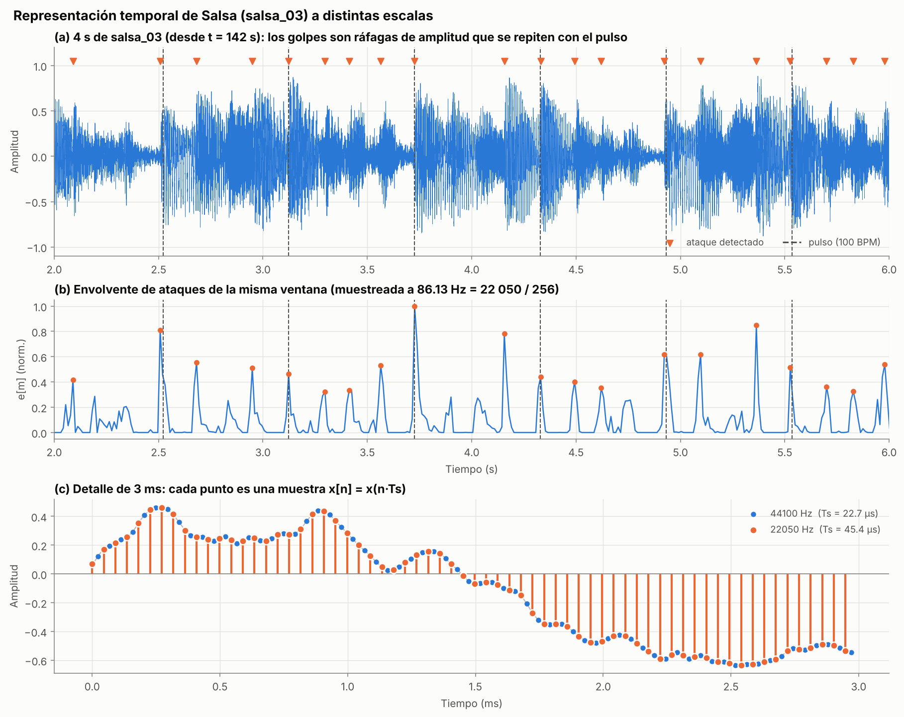

- **(a) 4 s de *Cali Pachanguero*:** los golpes son ráfagas de amplitud que se repiten. Los
  triángulos marcan los ataques detectados y las líneas punteadas el pulso estimado (100 BPM).
- **(b) La envolvente de ataques** de la misma ventana: una señal mucho más simple, con un pico
  por golpe. Es la señal cuyo periodo se mide.
- **(c) 3 ms:** cada punto es una muestra. A 44 100 Hz hay una cada 22,7 µs; a 22 050 Hz, una cada
  45,4 µs. Las muestras a 22 050 Hz siguen la forma de la señal porque casi no hay contenido por
  encima de 11 kHz.

### 7.3 Caracterización

Tabla completa en [`results/caracterizacion.md`](results/caracterizacion.md): duración, fs,
canales, número de muestras, mínimo, máximo, media, RMS, factor de cresta, muestras saturadas,
energía por banda, tempo y claridad del pulso de cada canción. Promedios por género
(`results/resumen_generos.csv`):

| Género | Tempo medido (BPM) | RMS (dBFS) | Cresta (dB) | Graves / medios / agudos | Claridad R[P] |
|---|---|---|---|---|---|
| Salsa | 92–105 | −11,9 | 12,2 | 26 / 61 / 10 % | 0,51 |
| Reggaetón | 95–111 | −12,4 | 14,0 | 58 / 35 / 6 % | 0,50 |
| Bachata | 120–134 | −14,3 | 14,1 | 41 / 51 / 7 % | 0,54 |
| Vallenato | 77–132 | −15,7 | 14,0 | 34 / 53 / 12 % | 0,52 |
| Cumbia | 83–103 | −16,6 | 15,7 | 45 / 41 / 13 % | 0,55 |
| Rock | 81–124 | −15,1 | 14,3 | 47 / 37 / 15 % | 0,43 |
| Electrónica | 123–129 | −13,6 | 14,7 | 44 / 41 / 12 % | 0,57 |

- **Media ≈ 0** en todas (|media| < 0,015): no hay componente DC apreciable; igual se resta al
  normalizar.
- **Saturación:** *Periódico de Ayer* tiene el 1,8 % de las muestras en ±1 (recortadas), un RMS
  de −7,2 dBFS y un factor de cresta de solo 8,8 dB: es una remasterización muy comprimida. Su
  correlación entre canal izquierdo y derecho es 0,99, prácticamente mono (es una grabación de
  los años 70). Las demás canciones tienen menos del 0,2 % de muestras saturadas.
- **Energía por banda:** el reggaetón concentra la mayor parte en los graves (58 %, el bajo
  electrónico); la salsa en los medios (61 %: campana, congas, piano y metales). Los agudos tienen
  poca energía en todos los géneros (6–15 %), aunque llevan muchos de los ataques.
- La **claridad del pulso** R[P] (autocorrelación de la envolvente en el periodo del pulso, de 0
  a 1) es parecida en todos los géneros (0,43–0,57): por sí sola no los distingue.

### 7.4 Espectro (FFT) y aliasing

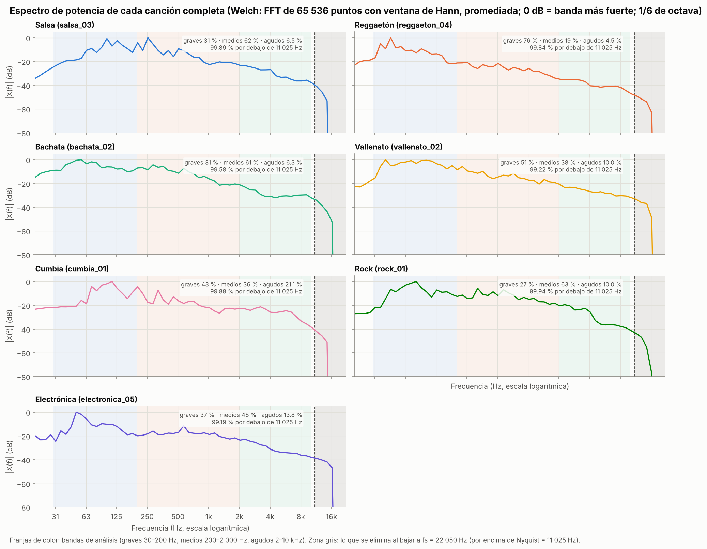

**Qué se calcula:** la densidad espectral de potencia de toda la canción por el **método de
Welch**: la señal se divide en bloques de 65 536 muestras (1,49 s) con 50 % de solapamiento, a
cada bloque se le aplica la ventana de Hann y la FFT, X_m[k] = Σ x[n + mH]·w[n]·e^(−j2πkn/N), y se
promedian los |X_m[k]|². La resolución es Δf = fs/N = 44 100 / 65 536 = 0,67 Hz; para poder leer
la curva, la potencia se promedia en bandas de 1/6 de octava. Se usa Welch en vez de una sola FFT
de toda la canción porque promediar reduce la varianza del estimador, y porque una FFT de 20
millones de muestras ocupa varios GB de memoria. **Eje x:** frecuencia en Hz en escala
logarítmica, de 20 Hz a fs/2 = 22 050 Hz. **Eje y:** potencia en dB respecto a la banda más fuerte.
Las franjas de color son las tres bandas que usa el sistema; la zona gris, lo que se descarta al
bajar a 22 050 Hz. La mayoría de las curvas caen bruscamente entre 15 y 20 kHz: es el filtro
pasabajos que aplica la compresión MP3.

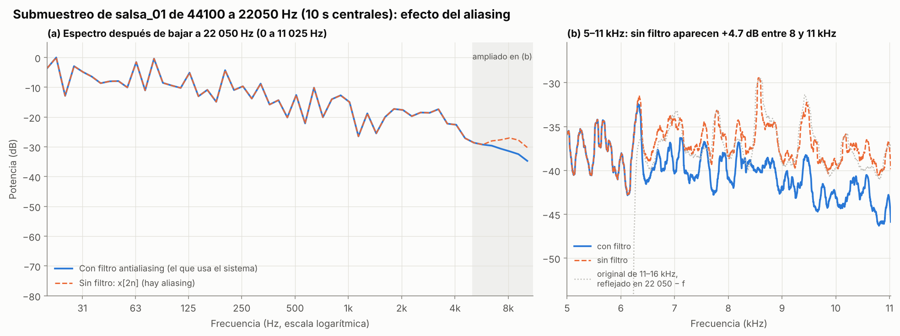

Para mostrar el aliasing se usa la canción con más energía por encima de 11 kHz (*Periódico de
Ayer*). Si se baja de 44 100 a 22 050 Hz tomando una de cada dos muestras, sin filtro, el
contenido entre 11 y 16 kHz se refleja dentro de la banda útil en f' = 22 050 − f: en (b) la
curva punteada gris (el original reflejado) coincide con los picos de la curva sin filtro. Aparece
**energía falsa entre 8 y 11 kHz (+4,7 dB)**, justo en la banda de los platillos y la güira. Con
el filtro antialiasing esto no ocurre.

### 7.5 Análisis rítmico de un fragmento

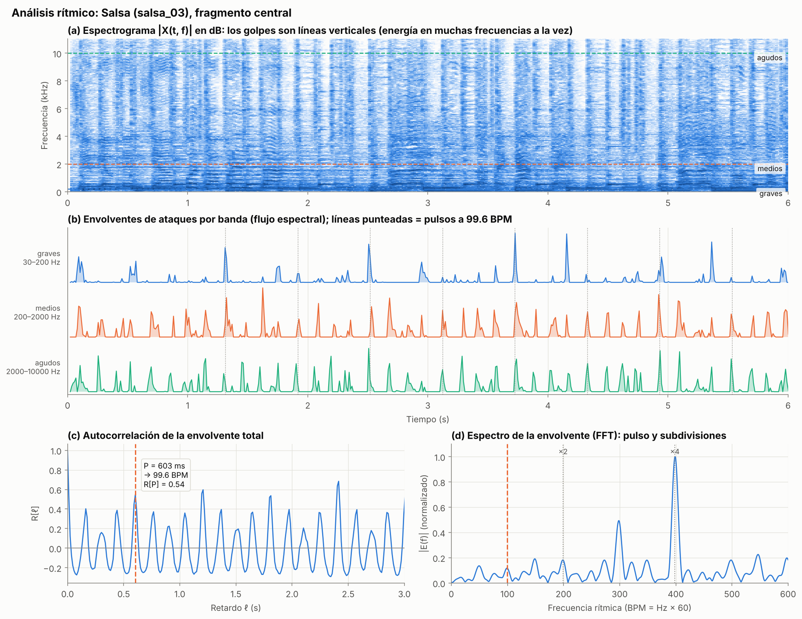

- **(a) Espectrograma:** los golpes de percusión son líneas verticales, porque un golpe tiene
  energía en muchas frecuencias a la vez; las notas sostenidas son líneas horizontales.
- **(b) Envolventes de ataques:** flujo espectral e_b[m] = Σ_k máx(0, L[k,m] − L[k,m−1]) con
  L = log(1 + 100·|X|), en cada banda. Graves = bombo y bajo; medios = caja, congas, campana;
  agudos = güira, platillos, maracas.
- **(c) Autocorrelación:** los picos están en múltiplos del periodo del pulso P. El tempo es
  60/P (en BPM). Se refina con interpolación parabólica para no depender de la resolución de
  11,6 ms. Aquí P = 603 ms → 99,6 BPM.
- **(d) Espectro de la envolvente:** la FFT de e[m] muestra el pulso y sus múltiplos. En la salsa
  el pico más alto está en ×4 (~400 golpes por minuto): las corcheas de la campana y las congas.

Hay una figura por género en `results/analisis_ritmico_<genero>.png`.

### 7.6 Tempo por género

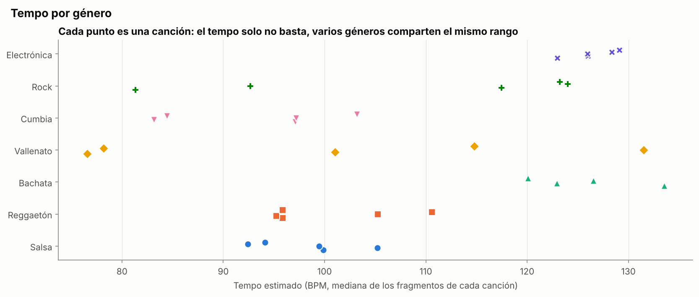

El tempo de cada canción es muy estable: entre los fragmentos de una misma canción varía en
promedio 4–7 BPM (13 BPM en el vallenato). Pero **el tempo solo no basta**: salsa, reggaetón y
cumbia comparten el rango de 83–111 BPM, y bachata, rock y electrónica el de 117–134 BPM.
Clasificar solo con el tempo acierta el 47 % de las canciones (7.10).

**Ambigüedad de octava:** la autocorrelación tiene picos en P, 2P y P/2, todos correctos
matemáticamente. El sistema elige con una preferencia perceptual centrada en 110 BPM. Por eso:

- La **salsa** se mide a la mitad de su tempo escrito (~100 en vez de ~200 BPM: cuenta por
  blancas). Lo hace igual en las 5 canciones, así que no perjudica al clasificador.
- El **vallenato** se mide unas veces a la mitad (~77 BPM en *Los Caminos de la Vida* y *Las
  Locuras Mías*) y otras no (~132 BPM en *Olvídala*). Esa inconsistencia es una de las razones por
  las que es el género que peor se clasifica.

Con los ritmos sintéticos, donde se conoce el tempo real, el estimador acierta el pulso exacto en
el 83 % de los 160 fragmentos, y el pulso o su mitad/doble en el 96 %.

### 7.7 Patrón de compás

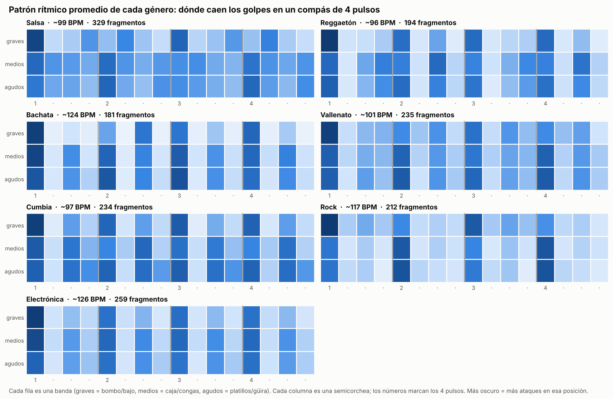

La envolvente de cada banda se divide en compases de 4 pulsos y cada compás en 16 casillas
(semicorcheas). Se promedia cada casilla sobre todos los compases del fragmento y se normaliza
entre 0 (la casilla más débil) y 1 (la más fuerte). El resultado es el dibujo del ritmo, y en
las canciones reales se reconocen los patrones de cada género:

- **Reggaetón:** en los medios (la caja), golpes en las semicorcheas 4, 7, 12 y 15: el **dembow**,
  agrupado 3 + 3 + 2.
- **Rock:** medios y agudos fuertes en los pulsos 2 y 4: la **caja en el contratiempo** del
  compás.
- **Electrónica:** graves iguales en los 4 pulsos: el bombo **"four on the floor"**.
- **Cumbia:** medios fuertes entre pulso y pulso (casillas 3, 7, 11 y 15): el **contratiempo** de
  la guitarra o el acordeón.
- **Bachata:** medios y agudos en cada pulso y en cada corchea: la **güira** y el bongó.
- **Salsa y vallenato:** ataques repartidos en casi todas las casillas (campana, congas,
  guacharaca), sin una posición dominante. Por eso el patrón los distingue menos.

Como no se sabe en qué casilla empieza el compás, además de la posición de los golpes se usa la
magnitud de la **DFT del patrón** de 16 pasos: |X[k]| no cambia si la secuencia se desplaza
circularmente, así que describe la forma del ritmo sin importar dónde empiece.

### 7.8 Efecto del ruido

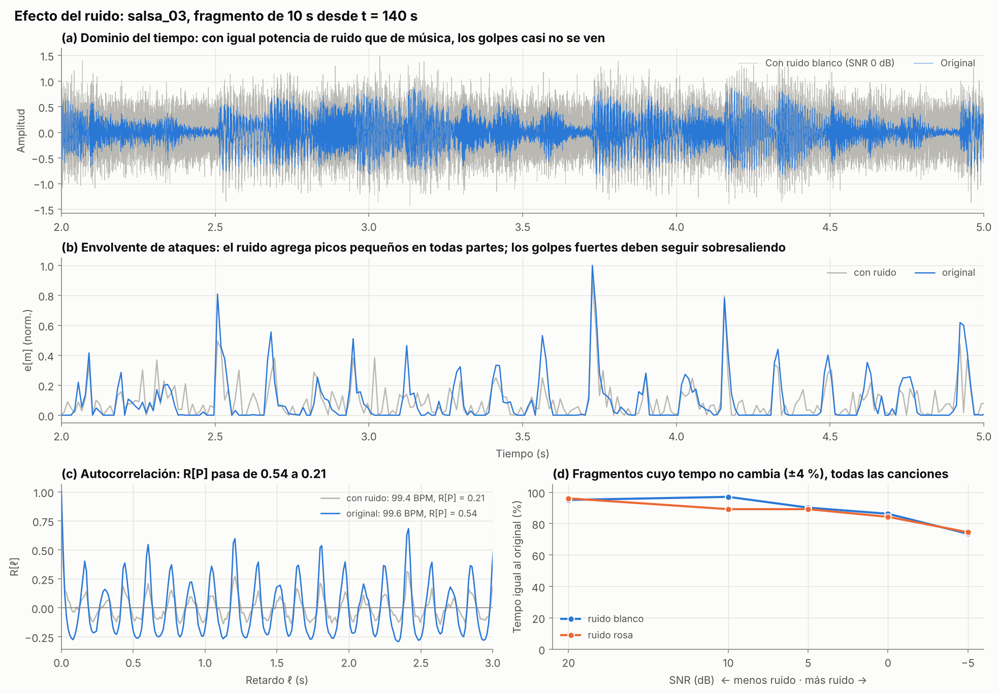

Fragmento de 10 s de *Cali Pachanguero* con **ruido blanco gaussiano a SNR = 0 dB** (igual
potencia de ruido que de música):

- **(a) Tiempo:** los golpes casi no se distinguen en la forma de onda.
- **(b) Envolvente:** el ruido agrega picos pequeños en todas partes, pero los golpes fuertes
  siguen sobresaliendo. El ruido blanco tiene la misma potencia en todas las frecuencias y tapa
  sobre todo los agudos, donde la música tiene poca energía; en los graves y medios la música
  sigue por encima del ruido.
- **(c) Autocorrelación:** la claridad del pulso baja de 0,54 a 0,21, pero el máximo sigue en el
  mismo retardo: el tempo pasa de 99,6 a 99,4 BPM.
- **(d) Todas las canciones** (3 fragmentos por canción, 102 en total): porcentaje de fragmentos
  cuyo tempo no cambia más de 4 %:

| SNR | 20 dB | 10 dB | 5 dB | 0 dB | −5 dB |
|---|---|---|---|---|---|
| Ruido blanco | 95 % | 97 % | 90 % | 86 % | 74 % |
| Ruido rosa | 96 % | 89 % | 89 % | 84 % | 75 % |

Incluso con más ruido que música (−5 dB), tres de cada cuatro fragmentos conservan el tempo.
Para que el ruido no domine, la envolvente total suma las tres bandas **con el mismo peso** (cada
una dividida por su desviación estándar). Si se suman todas las frecuencias directamente, los
agudos (el 90 % de los bins de la FFT) dominan: en una prueba con los ritmos sintéticos y ruido
blanco a 0 dB, el tempo se conservó en el 65 % de los fragmentos con la suma directa y en el 85 %
con las bandas de igual peso.

### 7.9 Segmentación

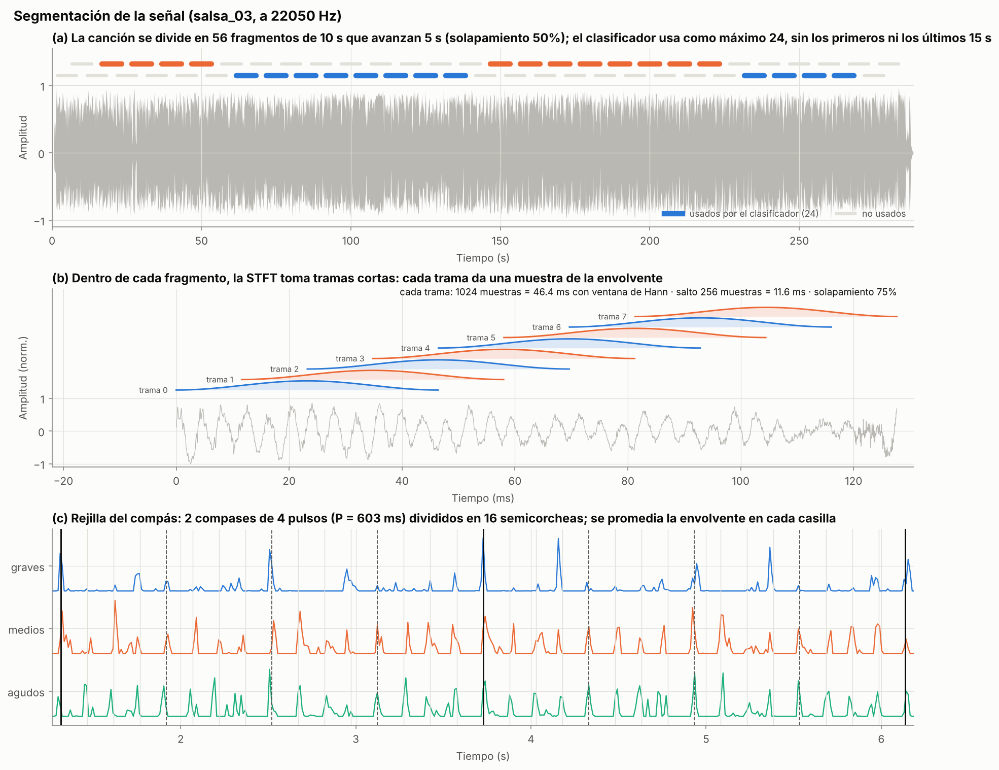

1. **Fragmentos de 10 s** con solapamiento del 50 %. 10 s contienen entre 3 y 5 compases,
   suficientes para medir un patrón. Para el clasificador, cada canción aporta **como máximo 24
   fragmentos**, repartidos a lo largo de la canción y **sin los primeros ni los últimos 15 s**
   (introducción y final, que suelen no tener la percusión completa). Así una canción de 7 minutos
   no pesa el triple que una de 2: en total son 809 fragmentos (24 por canción, salvo *We Will
   Rock You*, que dura 2 minutos y da 17).
2. **Tramas de la STFT** de 1 024 muestras (46,4 ms, Δf = 21,5 Hz) con ventana de Hann, que avanzan
   256 muestras (11,6 ms, solapamiento 75 %). Cada trama da una muestra de la envolvente. Se eligió
   una ventana corta porque aquí importa ubicar bien los golpes en el tiempo, más que separar
   frecuencias cercanas.
3. **Rejilla del compás:** 4 pulsos × 4 semicorcheas = 16 casillas.

### 7.10 Clasificación

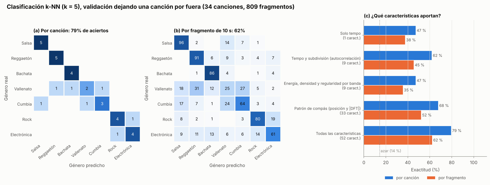

Cada fragmento se describe con **52 características**: tempo, claridad, autocorrelación en
fracciones del pulso, energía, densidad y regularidad de ataques por banda, posición de los golpes
en el compás, |DFT| del patrón y dinámica (detalle en `docs/metodologia.md`). Se estandarizan con
la media y la desviación del conjunto de entrenamiento y se clasifican con **k-NN (k = 5)**: votan
los 5 fragmentos más parecidos, con peso 1/distancia. El género de una canción es el más votado
entre sus fragmentos.

La validación **deja una canción por fuera**: se entrena con las otras 33 y se prueba con esa,
para cada una de las 34. Así nunca hay fragmentos de la misma canción en entrenamiento y prueba
(si los hubiera, el clasificador reconocería la canción y no el género).

| Características | Cantidad | Por fragmento | Por canción |
|---|---|---|---|
| Solo tempo | 1 | 38 % | 47 % |
| Tempo y subdivisión (autocorrelación) | 9 | 45 % | 62 % |
| Energía, densidad y regularidad por banda | 9 | 35 % | 47 % |
| Patrón de compás | 33 | 52 % | 68 % |
| **Todas** | **52** | **62 %** | **79 %** |

Azar: 14 % (7 géneros). Cada grupo de características aporta algo, y juntas funcionan mejor que
cualquiera por separado. El patrón de compás es el grupo que más aporta.

**Por género** (canciones bien clasificadas): salsa 5/5, reggaetón 5/5, bachata 4/4, rock 4/5,
electrónica 4/5, cumbia 3/5 y vallenato 2/5. Los 7 errores (`results/clasificacion_canciones.csv`):

| Canción | Real | Predicho | Votos |
|---|---|---|---|
| La Gota Fría | vallenato | cumbia | 85 % |
| Esta Vida | vallenato | reggaetón | 60 % |
| Olvídala | vallenato | bachata | 38 % |
| La Pollera Colorá | cumbia | vallenato | 59 % |
| El Pescador | cumbia | salsa | 54 % |
| Seven Nation Army | rock | electrónica | 48 % |
| Don't You Worry Child | electrónica | rock | 23 % |

- **Vallenato y cumbia** se confunden entre sí: son ritmos de la costa caribe con la guacharaca
  marcando las corcheas y tempos parecidos. Además el vallenato es el género más variado de la
  base: sus tempos medidos van de 77 a 132 BPM (7.6). *El Pescador* es una grabación en vivo con
  tambores tradicionales, distinta de las cumbias de estudio de la base.
- **Rock y electrónica** comparten compás de 4/4, tempo cercano a 125 BPM y bombo en el pulso.
  *Seven Nation Army* tiene un bombo muy regular, casi electrónico. Para separarlos haría falta el
  timbre (guitarras frente a sintetizadores), y este sistema mide solo el ritmo a propósito.

**Otras formas de describir el ritmo que se probaron:** la autocorrelación muestreada en retardos
fijos (Dixon et al., 2003) y el espectro de la envolvente en escala logarítmica (Peeters, 2005).
Las dos tienen la ventaja de no depender del tempo estimado. Con 5 géneros (24 canciones) dieron
entre 54 y 67 % por canción, frente al 79 % que dieron las 52 características actuales con esos
mismos 5 géneros, así que no se incluyeron.

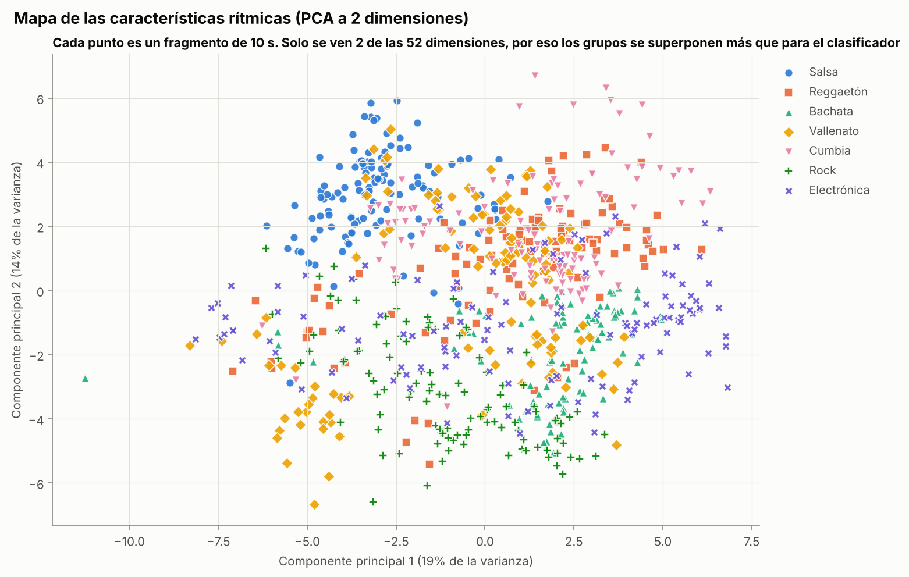

Proyección de los 52 valores a 2 dimensiones con análisis de componentes principales (PCA). La
salsa forma un grupo separado (arriba a la izquierda) y rock y bachata ocupan la parte inferior,
mientras que vallenato y cumbia se mezclan con los demás, como en la matriz de confusión. En 2 de
52 dimensiones los grupos se superponen más de lo que los ve el clasificador.

## 8. Referencias

1. G. Tzanetakis and P. Cook, "Musical genre classification of audio signals," *IEEE Trans.
   Speech and Audio Processing*, vol. 10, no. 5, pp. 293–302, 2002.
2. J. P. Bello, L. Daudet, S. Abdallah, C. Duxbury, M. Davies and M. Sandler, "A Tutorial on Onset
   Detection in Music Signals," *IEEE Trans. Speech and Audio Processing*, vol. 13, no. 5,
   pp. 1035–1047, 2005.
3. D. P. W. Ellis, "Beat Tracking by Dynamic Programming," *Journal of New Music Research*,
   vol. 36, no. 1, pp. 51–60, 2007.
4. S. Dixon, E. Pampalk and G. Widmer, "Classification of Dance Music by Periodicity Patterns," in
   *Proc. 4th Int. Conf. on Music Information Retrieval (ISMIR)*, 2003.
5. F. Gouyon and S. Dixon, "Dance Music Classification: A Tempo-Based Approach," in *Proc. 5th
   Int. Conf. on Music Information Retrieval (ISMIR)*, 2004.
6. G. Peeters, "Rhythm Classification Using Spectral Rhythm Patterns," in *Proc. 6th Int. Conf. on
   Music Information Retrieval (ISMIR)*, 2005.
7. M. Müller, *Fundamentals of Music Processing*, 2nd ed. Springer, 2021 (cap. 6: tempo y pulso).
8. A. V. Oppenheim and R. W. Schafer, *Discrete-Time Signal Processing*, 3rd ed. Pearson, 2010.
9. P. Virtanen et al., "SciPy 1.0: Fundamental Algorithms for Scientific Computing in Python,"
   *Nature Methods*, vol. 17, pp. 261–272, 2020.
10. C. R. Harris et al., "Array programming with NumPy," *Nature*, vol. 585, pp. 357–362, 2020.
11. J. D. Hunter, "Matplotlib: A 2D Graphics Environment," *Computing in Science & Engineering*,
    vol. 9, no. 3, pp. 90–95, 2007.

**Herramientas:** el código se escribió con apoyo de Claude (Anthropic) como asistente de programación.
